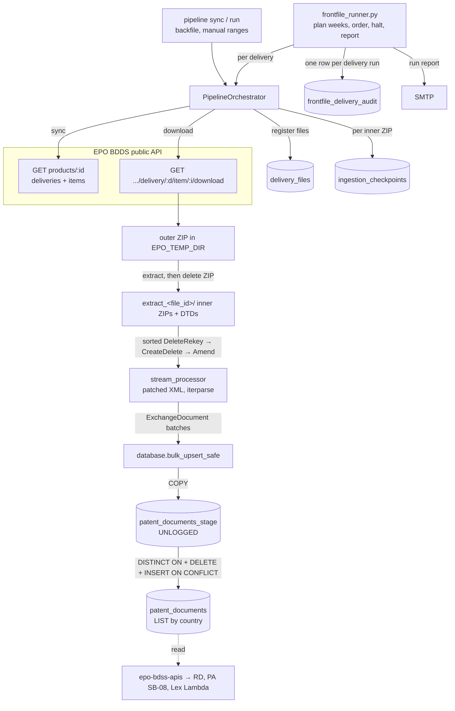
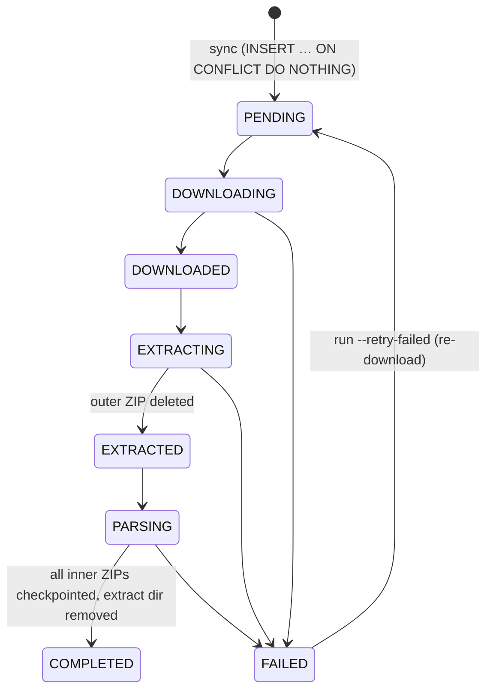

# docdb_ingestion — Architecture

Style: a **single-process batch ETL**, run by an operator or a scheduler. No service, no queue and no API. State lives in PostgreSQL tables, so a run can be stopped and resumed. Parallelism is by separate processes with non-overlapping file ranges (`docdb_ingestion/pipeline.py`, `docs/server_run_guide.md`).

The design rationale for the single partitioned table is in `docdb_ingestion: docs/single_table_partitioned_design.md`.

## Components

| Module | Role |
|---|---|
| `docdb_ingestion/epo_api.py` | EPO BDDS client: list a delivery's items; stream-download one item to disk |
| `docdb_ingestion/pipeline.py` | `PipelineOrchestrator`: `sync` registers a delivery's files, and `run` moves each file through the state machine below. Also the backfile CLI |
| `docdb_ingestion/stream_processor.py` | Opens one inner ZIP, patches the XML's DOCTYPE with entity declarations, and streams `exch:exchange-document` elements into `ExchangeDocument` models |
| `docdb_ingestion/models.py` | Pydantic models: `ExchangeDocument` plus its application, publication, parties, priorities, classifications, citations, texts, designations and availability dates. It carries `operation` (the document status) |
| `docdb_ingestion/database.py` | DSN resolution (env or Secrets Manager), schema bootstrap, checkpoint and state queries, the **staged COPY + merge** upsert, the front-file audit row |
| `docdb_ingestion/aws_secrets.py` | Cached Secrets Manager fetch (same design as the `scripts` DRM job) |
| `docdb_ingestion/notifications.py` | SMTP helper for run reports (same design as the `scripts` DRM mailer) |
| `frontfile_runner.py` | Weekly outer loop: plan the deliveries after `BACKFILE_TIME`, order them, skip finished ones, halt on failure, email a report |
| `process_folder.py`, `main.py` | Load ZIPs from a local folder (`main.py` works from an `index.xml`); development paths that bypass `delivery_files` |
| `query_biblio.py`, `export_sample_excel.py` | Developer read utilities over `patent_documents` |
| `merge_fast.py` | Earlier-schema utility (local DB → RDS copy) |
| `monitor_workers.sh` | Terminal dashboard for running `pipeline run` processes |

## End-to-end flow

## The file state machine (`delivery_files.status`)

- **Resume** starts at the recorded step. A file left in `DOWNLOADING` is downloaded again. A file left in `PARSING` resumes from its `extract_<file_id>/` directory in the same `EPO_TEMP_DIR`; if that directory is gone, `--retry-failed` re-downloads it.
- **Inner-ZIP checkpoints** (`ingestion_checkpoints`, keyed by the inner ZIP's basename) let a re-run skip inner volumes that already completed. A crash mid-volume re-processes that volume from its start; the merge is an idempotent upsert or delete.
- `FAILED` stores the full traceback in `delivery_files.error_message`. `run()` skips `FAILED` rows unless `--retry-failed` is set.
- `.csv` items (EPO's front-file "coherence" files) are marked `COMPLETED` without being read.

## Parsing (`stream_processor.py`)

1. The first `.xml` in each inner ZIP is extracted into a system temp directory, with the delivery's DTD files copied alongside.
2. The first 8 KB is rewritten to declare HTML5 and ISO-SGML entities (`&dgr;`, `&ldquo;` and so on), and the rest is streamed with unknown `&name;` references escaped. This lets deliveries without `Root/DTDS/` parse.
3. `lxml.iterparse` on `exch:exchange-document` end events; each element is cleared after use, so memory stays flat.
4. **Status handling:**
   - `CV` / `DV` (void stubs) → `operation='SKIP'`;
   - `D` / `V` → delete;
   - everything else (`C`, `A`) → upsert of the whole row.
5. **Field choices:**
   - Parties: `docdb` > `docdba` > `original` per (type, sequence).
   - Priorities: `docdb` format, de-duplicated.
   - Classifications: `patent-classifications`.
   - `is_grant` = the kind code is in `{B1,B2,B3,C,C1,C2,E}` **or** a `printed-with-grant` date exists.
6. **`extra_data`:** the element is converted to a dict and the mapped blocks are pruned; the rest goes to `pub_extra_data` / `app_extra_data`.
7. A corrupt inner ZIP is logged as `Bad ZIP file`; see [operations-and-troubleshooting.md](operations-and-troubleshooting.md).

## Writing (`database.bulk_upsert_safe`)

Once per batch (`DOCDB_BATCH_SIZE`, default 1000), in **one transaction**:

1. `DELETE` the stage rows for this `stage_key` (the inner ZIP name).
2. `COPY` the batch into the UNLOGGED `patent_documents_stage`, with `stage_seq` in input order.
3. One statement:
   - `DISTINCT ON (country, pub_doc_id)` keeps the **last** occurrence in the batch;
   - a data-modifying CTE deletes the targets whose status is `D` / `DV` / `V`;
   - `INSERT … ON CONFLICT (country, pub_doc_id) DO UPDATE` replaces every column of the rest; `created_at` is kept and `updated_at` set to `NOW()`.
4. `DELETE` the stage rows again, then commit.

Rows are inserted into the parent table, and Postgres routes each one to its country partition.

## Ordering rules (re-keys)

EPO requires DeleteRekey → CreateDelete → Amend so that a re-keyed publication is deleted before it is re-created (see `docdb_ingestion: EPO Data Extraction and Database Integration.md`). The code enforces the order at every level:

| Level | Where | Rule |
|---|---|---|
| Weeks | `frontfile_runner.filter_and_group_deliveries` | Week token `YYYY/NNN` parsed from the delivery name, ascending |
| Deliveries within a week | `_delivery_type_order` | DeleteRekey (1) → Cr-Del / CreateDelete (2) → Amend (3) → unknown (9) |
| Inner ZIPs within a file | `pipeline.run` `zip_sort_priority` | Same order by filename keyword |
| Records within a batch | the merge's `DISTINCT ON … stage_seq DESC` | The last record per key wins |

A failed delivery **halts** the runner, so later weeks are not applied on top of a partial week.

## Front-file runner (`frontfile_runner.py`)

1. `EPO_FRONTFILE_PRODUCT_ID` and `BACKFILE_TIME` are required; without them the run stops before doing anything, and the report says so.
2. Fetch every delivery of the product. Drop those published on or before `BACKFILE_TIME` or whose name has no week token. Group and order them.
3. Mode: `catchup` plans every outstanding week in order; `latest` plans only the newest week.
4. Classify each planned delivery from one read of `delivery_files`: NEW (no rows), OUTSTANDING or DONE.
5. For each delivery:
   - `catchup` skips DONE deliveries unless `--force-sync` is set.
   - A delivery with FAILED files halts the run unless `--retry-failed` is set.
   - Otherwise: a new orchestrator (a new connection plus the schema bootstrap), `sync`, then (in `latest`) skip if nothing is outstanding, then `run`.
6. Every non-dry run emails a report (`--no-email` suppresses it). The exit code is 1 on halt or abort.

## External systems

| System | Direction | How |
|---|---|---|
| EPO BDDS public API | Read | `requests.get`, no credentials. `EPO_API_BASE_URL` overrides the built-in base URL; set it in the process environment so both the listing and the downloads use it |
| PostgreSQL (the `patent_documents` store) | Read/write | `psycopg` 3; one connection per `DatabaseManager` |
| AWS Secrets Manager | Read | When `USE_SECRET_MANAGER=true`. Cached per process; refetched once on a password-authentication failure |
| SMTP | Write | Run report |
| epo-bdss-apis | Downstream reader | Reads `patent_documents` by `(country, doc_number)` and `(app_country, app_number)` |
