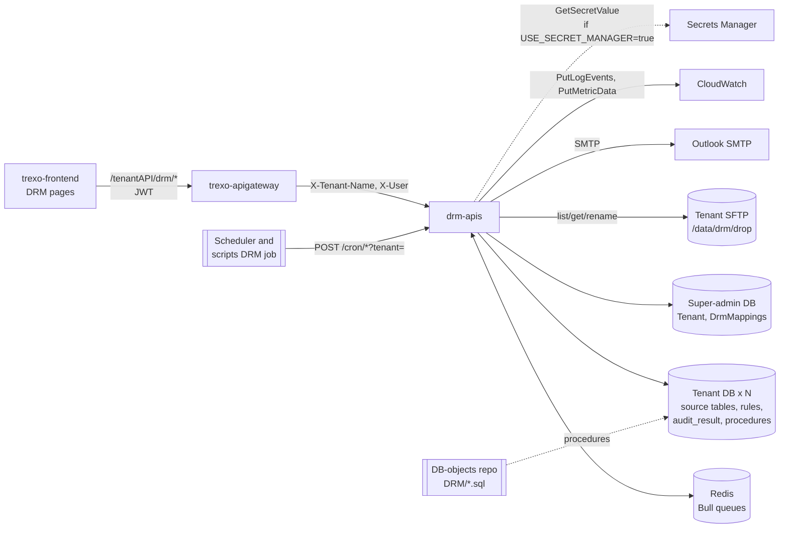
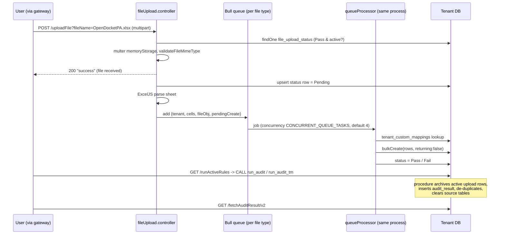
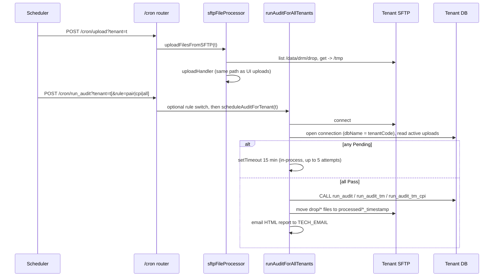

# drm-apis — Architecture

Read `drm-apis: docs/architecture.md` first. It covers module layout, middleware order and tenant resolution. This file adds the end-to-end picture and the diagrams.

## Style

A modular monolith in a single Node process. That process is at once:
- an Express API,
- a Bull worker (20 queue processors registered in the same process),
- a set of HTTP-triggered "cron" handlers that run their workflow inside the request.

All three share one in-memory tenant connection cache, `global.tenantConnections`.

Most business logic lives in the database as PL/pgSQL procedures, one family per tenant DB. The Node layer parses, loads, calls a procedure and returns rows.

## System context

## Upload → audit → review (the core path)

## Scheduled path

## Startup sequence

1. `loadEnv.js` loads the dotenv chain (`@dotenvx/dotenvx`).
2. Modules load. Super-admin models (`Tenant`, `DrmMappings`) are defined against a **Proxy** until credentials are known (`database.js` `createDbProxy`). Touching one before init throws `Model "…" accessed before database initialization`.
3. `resolveDbCredentials()` reads either env vars or Secrets Manager. Failure stops the process.
4. `initializeDatabaseConnections()` builds the real super-admin Sequelize and replays the deferred model definitions.
5. `registerQueueProcessors()` runs. Jobs waiting in Redis start processing from this point.
6. The super-admin DB authenticates (failure is logged).
7. For each tenant: open a Sequelize pool (max 20), then `sync()` the `users`, `tenant_custom_mappings` and `user_column_preferences` tables.
8. `app.listen`.

## State

| State | Where | Lifetime |
|---|---|---|
| Tenant connection pools and models | `global.tenantConnections` | Process lifetime; tenants added after boot are resolved on their first request |
| Tenant loggers | `tenantLogger` map | Process lifetime; each has a CloudWatch transport and a 2 s flush timer |
| DB credentials | `credentialsStore` | Process lifetime; a credential change takes effect on restart |
| Queued file contents | Redis (Bull job data) | Completed jobs are kept (`removeOnComplete: false`) |
| Pending-audit retry timers | Node `setTimeout` | In memory; a restart clears them |
| Upload and audit status | Tenant DB `file_upload_status` | Durable |
| Cron DB connections | A `Sequelize` instance per cron call (pool max 10) | Per call |

## Request-scoped context

`requestContext.js` uses `AsyncLocalStorage`, so tenant SQL debug logs reach the active request's child logger without mutating the shared Sequelize instance (`database.js` `logTenantQuery`).

## Caching

Connections, loggers and credentials are cached as above. `DrmMappings` is read from the super-admin DB on each `fetchAuditResult` call.

## File processing

- Files are processed in memory: the Multer buffer, then ExcelJS workbook objects, then an array of rows, then the Bull job in Redis, which the worker reads.
- Header rows are skipped by finding the last **bold** cell in column A within the first 20 rows (`checkLastColumnBold`). The last data row (the export's footer) is dropped unless the mapping sets `includeLastRow`.
- Column mapping is positional (`queue/queueMappings.json`). When a client changes its export layout, add a `tenant_custom_mappings` entry for that tenant.

## Module boundaries

- `controllers/fileUpload.controller.js` exports `uploadHandler`, which `cron/sftpFileProcessor.js` reuses for SFTP files by building a `req`-shaped object. Changes to `uploadHandler` affect both paths.
- The cron code builds its own DB connections (`cron/cronHelpers.js`) using the **tenant code** as the database name; the API uses `Tenant.dbName`.
