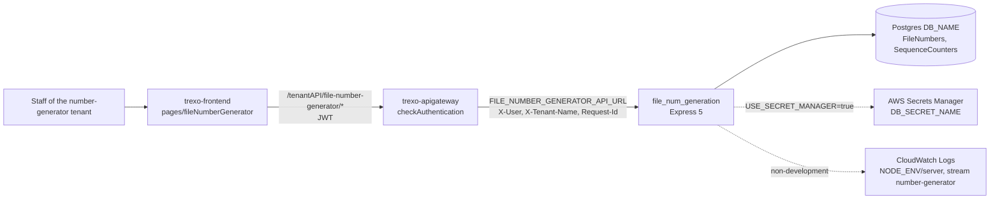
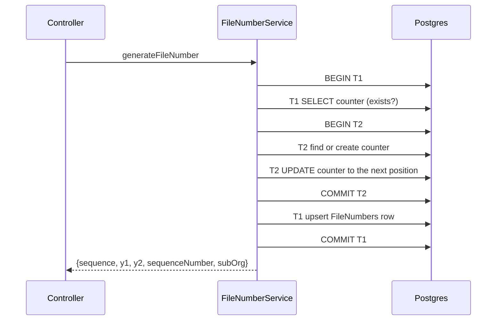

# file_num_generation — Architecture

Read `file_num_generation: .claude/docs/ARCHITECTURE.md` (modules, data movement, boundaries) and `FLOW.md` (the header and validation path) alongside this file. This file adds the system context, the numbering transaction layout, start-up and logging.

## Style

A single-process, layered Express service: routes → controller → one service class (static methods) → Sequelize models → one Postgres database. It is stateless between requests; the shared state is the `SequenceCounters` table. There is no cache, queue or file storage. The export is built in memory and sent in the response.

## System context

## Numbering transaction layout

- **Bulk** uses one transaction: counter read, N row writes, then one counter update.
- **Delete** removes the row and applies the rewind in one transaction.
- The transaction isolation level is the Postgres default (READ COMMITTED).
- The Sequelize pool is `max: 5`, `min: 0`, `acquire: 30000`, `idle: 10000` (`src/models/index.js`).

## Start-up sequence

1. `loadEnv.js` loads `.env`, `.env.local`, `.env.<NODE_ENV>` and `.env.<NODE_ENV>.local`, each overriding the previous one. It loads nothing when `NODE_ENV=test`.
2. `src/models/index.js`: in env mode, the Sequelize connection is built when the module loads. In Secrets Manager mode it waits for the credentials.
3. `startServer()`: `resolveDbCredentials()` → `initializeDatabaseConnections()` → `sequelize.authenticate()`. Any failure is logged and the process exits with code 1.
4. `app.listen(PORT || 8015)`. On `SIGTERM` the service closes the server, then Sequelize, then exits.
5. `uncaughtException` and `unhandledRejection` are logged, and the process exits.

The service does not run `sync()` or migrations at start-up.

`GET /health` is registered before the header middleware. It needs no headers and does not touch the database; it confirms that the process is up.

## Logging

| Environment (`NODE_ENV`) | Transport | Where |
|---|---|---|
| `test` | Silent console | — |
| `development` | Colour console plus `winston-daily-rotate-file` | `logs/%DATE%.log` (15 days, gzipped). Lines are prefixed `[requestId] [tenant] [email]` |
| any other value | `DailyRotateCloudWatchTransport` (batched) | Log group **`<NODE_ENV>/server`**, stream `number-generator`, JSON with `requestId` and `username` metadata. Batches that cannot be sent are written to `logs/cw_dead_letter.log` in the container |

- The CloudWatch clients use `AWS_ACCESS_KEY_ID` / `AWS_ACCESS_KEY_SECRET` and `AWS_REGION`. Retention comes from `LOG_RETENTION_DURATION_IN_DAYS`.
- The gateway sends `Request-Id`, and the service uses it as `requestId`, so a request can be followed across both logs.
- `src/utils/logger/index.js` also defines `createTenantLogger` and `crontabLogger`. Request handling uses the shared `logger`.

## Models in the codebase

| Model | Use |
|---|---|
| `FileNumber` | Every issued number |
| `SequenceCounter` | One counter per series |
| `MatterTypeMapping` | Defined, with an initialiser (`initializeMatterTypeMappings`) that no route calls; request handling uses `MATTER_TYPE_MAPPINGS` in the service |
| `FileNumberReservation` | Defined and loaded; not used by request handling |

`config/config.json` is a legacy Sequelize config file that `.sequelizerc` no longer reads. `.claude/docs/CONSTRAINTS.md` says not to open it.
