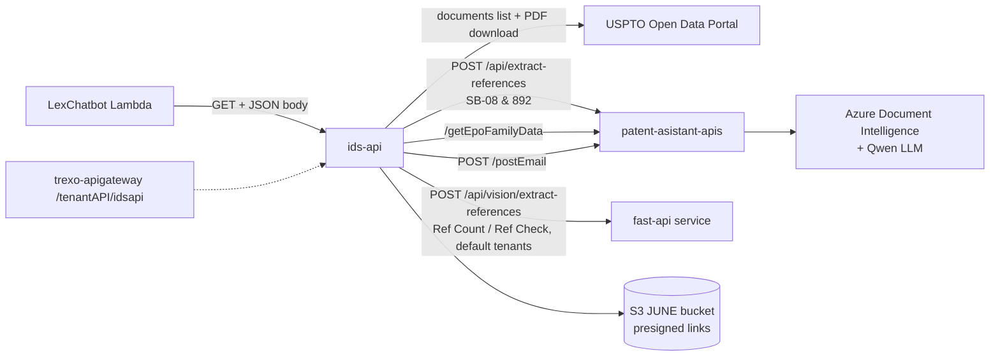

# ids-api — Knowledge Transfer

Describes the code as of 2026-09-18 (`origin/main` at `72f3c6d`). The **SB-08 and 892 Reference Analysis** module (TAI-1181 / TAI-1201) is documented in detail; the other modules are summarised.

## What it is

An Express 5 service that answers the **IDS** (Information Disclosure Statement) tasks of the JUNE IP Assistant chatbot. For US application numbers it:
1. pulls the prosecution-file documents from the USPTO Open Data Portal (`API_URL` / `API_TOKEN`);
2. extracts the cited references from them with OCR and an LLM;
3. writes an Excel or ZIP deliverable to S3 and returns a presigned link;
4. has `patent-asistant-apis` email the user.

| Module | Route | Lex intent | Documented here |
|---|---|---|---|
| **SB-08 and 892 Reference Analysis** | `GET /ids-api/sb08-892` | `Sb08And892Intent` | In detail |
| Reference Count | `GET /ids-api/data` | `IdsReferenceCountIntent` | Summary |
| IDS document download | `GET /ids-api/download` | `IdsDocumentDownloadIntent` | Summary |
| Reference Check | `GET /ids-api/ref-check` | `RefCheckIntent` | Summary |
| Citation Matrix | `POST /ids-api/citation-matrix` (xlsx upload) | — | Summary (added 2026-09-16) |

## Who calls it

- **The LexChatbot Lambda** (`pa_lambda_functions: LexChatbot/lambda_function/ids_count_handler.py`) calls `{IDS_API_BASE_URL}/ids-api/<route>` as a **GET with a JSON body**, waiting up to 900 s.
- `trexo-apigateway` also maps `/tenantAPI/idsapi/*` → `IDS_SERVICE_URL`.

## Stack

- Node 24 (`node:24-alpine`, port 8007); Express 5.
- `helmet`, `hpp`, `compression`; Joi validation (TP-269).
- axios, form-data, ExcelJS, adm-zip, xml2js.
- AWS S3 with presigned URLs.
- Winston with a CloudWatch transport.
- `dotenv-flow` for configuration.
- Jest 30 with Supertest and `jest-junit`; Jenkins CI (`Jenkinsfile`).

There is no database and no queue: each task runs within its HTTP request.

## How it fits

## Run locally

1. `npm ci`.
2. Configure through `dotenv-flow`; the variable names are in [deployment-and-environments.md](deployment-and-environments.md).
3. `npm run start:local` (nodemon; `APP_TARGET=local` turns on console logging).
4. Every request needs `X-Tenant-Name` and a JSON `X-User`.
5. SB-08/892 also needs a reachable `patent-asistant-apis` that serves `POST /api/extract-references` (see `ids-api: docs/TAI-1181-deployment.md` step 1).

Tests: `npm test`. Coverage floors: 80% lines/functions/statements and 70% branches.

## Existing documentation

| Doc | Use it for |
|---|---|
| `ids-api: README.md` | Setup, validation, test layout and CI |
| `ids-api: docs/TAI-1181-deployment.md` | The SB-08/892 rollout runbook: 6 systems in order, DB inserts (`IpApps`, tenant and user mappings), Lex build, Redis flush, verification, rollback |

## This package

| File | For |
|---|---|
| [product-and-features.md](product-and-features.md) | SB-08/892 business rules, and a summary of the other modules |
| [architecture.md](architecture.md) | The end-to-end sequence and extraction-backend routing |
| [api-and-integrations.md](api-and-integrations.md) | Routes, request and response contracts, the extract-references contract |
| [auth-security.md](auth-security.md) | Header handling, entitlement, deliverables |
| [deployment-and-environments.md](deployment-and-environments.md) | Branches, Jenkins, configuration, deploy order |
| [handover.md](handover.md) | The handed-over module, recent work, tests, dependencies, ownership |

There is no database or queue to document; testing is covered in the repo README and [handover.md](handover.md#tests).

## Suggested reading order

[product-and-features.md](product-and-features.md) → `docs/TAI-1181-deployment.md` → [architecture.md](architecture.md) → [api-and-integrations.md](api-and-integrations.md) → [handover.md](handover.md). Then the `patent-asistant-apis` package ([../patent-asistant-apis/README.md](../patent-asistant-apis/README.md)) for the extraction engine behind it.
