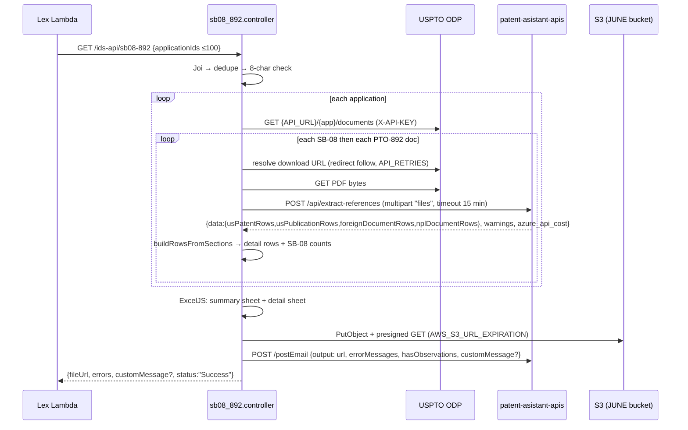

# ids-api — Architecture

This focuses on the SB-08/892 path.

## Style

A stateless Express 5 service with thin routes, controllers that hold the task logic, and a few service wrappers. Each task is a single HTTP request that runs to completion; the deliverable goes to S3 and the email is sent by `patent-asistant-apis`.

```
app.js      helmet, hpp, compression, json, header gate (X-User JSON, X-Tenant-Name) → req.logger child
routes/     /ids-api/* → validate(Joi) → controller
controllers/ sb08_892, ids_api (count + download), refcheck, citationMatrix
services/   referenceExtraction (SB-08/892 row builder) → patent-assistant/extract_references
            fast-api/ocr_ids_data (per-tenant backend switch), fast-api/epo_data
utils/      fetchData (ODP), filesCloud (S3 + presign), sendMail (PA /postEmail), date
logger/     Winston + CloudWatch daily-rotate transport
```

## SB-08/892 sequence



## Extraction backends

| Caller | Function | Backend |
|---|---|---|
| SB-08/892 | `services/patent-assistant/extract_references.js` | `PATENT_ASSISTANT_URL/api/extract-references`, which auto-detects the form type and runs deterministic repair passes (see the module comment for the choice) |
| Reference Count, Ref Check, Citation Matrix | `services/fast-api/ocr_ids_data.js` `extractReferencesWithOcrAndLlm` | `FAST_API_URL/api/vision/extract-references`, with model, OCR flag and prompts from `FETCH_PDF_DATA_*`; tenants in `TENANTS_EXCEPTION` use `patent-asistant-apis` instead |

Both backends return the same four-section shape. `normalizeApiCost` accepts `azure_api_cost` (patent-asistant-apis) and `total_api_cost` (fast-api), so either backend can serve.

## State and resources

- Nothing persists in the service. Memory holds the current PDF buffer, the detail rows for up to 100 applications, and the workbook buffer.
- The only cross-request state is the tenant logger map (`logger/index.js`).

## Dependencies to keep in mind

1. **`patent-asistant-apis` must serve `POST /api/extract-references`** before ids-api's SB-08/892 goes live in an environment (see the deploy order in [deployment-and-environments.md](deployment-and-environments.md)).
2. **The Lambda waits up to 900 s.** The controller finishes the task and sends the email regardless, so for long batches the email is the delivery channel.
3. **The email step is part of the task:** the controller reports success after `/postEmail` succeeds.
4. **ODP retries** use `API_RETRIES`, so set it in every environment.
