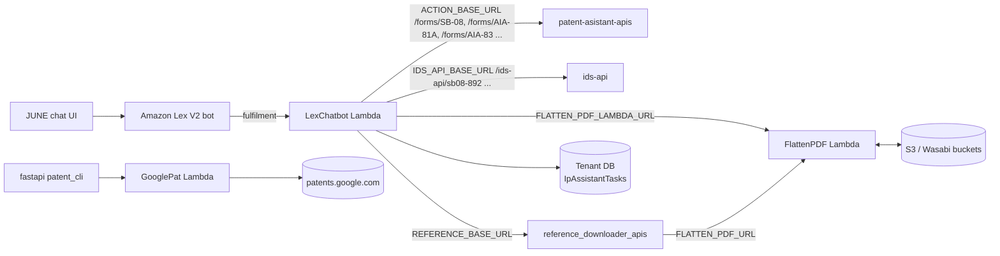

# pa_lambda_functions — Knowledge Transfer (focus areas)

Describes the code as of 2026-09-18 (`main` at `f2580d7`). This package covers **Embedded Font Removal (FlattenPDF)** and the **handed-over Lex intents** in depth; the rest is summarised.

## What it is

A monorepo of three AWS Lambda functions (Python) behind the JUNE / IP Assistant chatbot and related services.

| Lambda | Purpose | Covered |
|---|---|---|
| **FlattenPDF** | "Embedded Font Removal": turns patent PDFs into font-free, grayscale, US-Letter PDFs (USPTO-compliant) using Ghostscript. Also used as a service by `reference_downloader_apis` | In depth |
| **LexChatbot** | The Amazon Lex V2 fulfilment Lambda: one entry point that routes ~35 intents to handlers, which call the Trexo services, record a task row, and reply to the chat | In depth for `Sb08Intent` (SB-08 Generator), `Sb08And892Intent`, `AIA81ADocgenIntent`, `AIA83DocgenIntent`, `FlattenPdfIntent`, and the history of `EPOBiblioIntent` / `GlobalPatentIntent` |
| **GooglePat** | Resolves a patent number to a Google Patents PDF link via `patents.google.com`; called by the `fastapi` repo's `patent_cli` router | Overview |

## How it fits

## Stack

- Python 3.12 (bundler); PyMuPDF, img2pdf, pikepdf, Pillow (FlattenPDF).
- Ghostscript and poppler-utils as Lambda layers.
- `requests` for HTTP; SQLAlchemy with Alembic migrations (LexChatbot task tables); boto3.

The Lambdas are packaged with `lambda_bundler.py` and deployed by hand. The Lex bot (intents, slots, builds) is configured in the AWS console; the utterance lists live in `LexChatbot/Intents/*.txt`.

## Existing documentation

| Doc | Use it for |
|---|---|
| `pa_lambda_functions: FlattenPDF/PDF_PROCESSING_SERVICE_DOCUMENTATION.md` | The primary FlattenPDF doc: pipelines, per-page classification, gs commands, output handling, troubleshooting. For limits and variable names, use the values in [api-and-integrations.md](api-and-integrations.md#current-values-in-code) |
| `pa_lambda_functions: FlattenPDF/docs/lambda_function_documentation.md` | Deep dive: UML, sequence diagrams, scenarios, a KT section |
| `pa_lambda_functions: FlattenPDF/Readme.md` | Building the Ghostscript and poppler-utils layers |
| `ids-api: docs/TAI-1181-deployment.md` | The SB-08 & 892 rollout, including this repo's Lambda step and the Lex build |

## This package

| File | For |
|---|---|
| [product-and-features.md](product-and-features.md) | FlattenPDF behaviour and limits; the focus intents |
| [architecture.md](architecture.md) | The LexChatbot fulfilment flow; the FlattenPDF request path |
| [api-and-integrations.md](api-and-integrations.md) | The FlattenPDF contract, current values, LexChatbot outbound calls, config names |
| [auth-security.md](auth-security.md) | Trust model and data handling |
| [deployment-and-environments.md](deployment-and-environments.md) | Building, layers, migrations, the Lex build, per-environment settings |
| [handover.md](handover.md) | Handed-over areas, history, dependencies, ownership |

The task table is described in [architecture.md](architecture.md).

## Suggested reading order

`FlattenPDF/PDF_PROCESSING_SERVICE_DOCUMENTATION.md` → [api-and-integrations.md](api-and-integrations.md) → [architecture.md](architecture.md) → [product-and-features.md](product-and-features.md) → [deployment-and-environments.md](deployment-and-environments.md) → [handover.md](handover.md).
