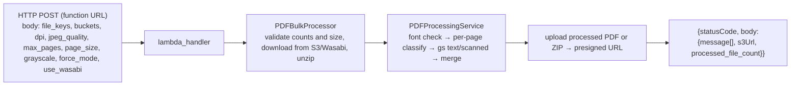

# pa_lambda_functions — Architecture (LexChatbot fulfilment; FlattenPDF summary)

FlattenPDF's internals are documented in `FlattenPDF/PDF_PROCESSING_SERVICE_DOCUMENTATION.md` and `FlattenPDF/docs/lambda_function_documentation.md`.

## LexChatbot: one Lambda, many intents

```mermaid
sequenceDiagram
  participant U as JUNE UI / patent-asistant-apis chat
  participant X as Lex V2 bot
  participant H as lambda_handler
  participant DB as Tenant DB (IpAssistantTasks)
  participant S as Handler (docgen / ids_count / flatten ...)
  participant T as Trexo service
  U->>X: utterance + sessionAttributes (user, tenantName, requestId, sessionId, forwardHeaders)
  alt invocationSource = DialogCodeHook
    X->>H: per-turn hook (CreateCustomFormIntent acts; others Delegate)
  else fulfilment
    X->>H: event (intent, slots, sessionState)
    H->>DB: upsert task by originatingRequestId (status PENDING, request_json)
    H->>H: restore large_slot_data (for big payloads)
    H->>S: INTENT_HANDLERS[intent].handler(intent, slots, session_state)
    S->>T: HTTP (timeout 900 s)
    T-->>S: url / errors / customMessage
    S-->>H: (status, url, lexResponse, error)
    opt intent not in the no-email list
      H->>T: send_email → patent-asistant-apis /postEmail
    end
    H-->>X: Lex response (Close + message)
  end
```

(`lambda_handler.py` `lambda_handler`, `IntentProcessor`, `TaskManager`.)

**Key pieces:**
- **`INTENT_HANDLERS`** maps intent → `{task, subtask, handler}`. `task` and `subtask` feed the task row and the "Track Task" UI. **The subtask text must match `IpApps.subtask_name`** in the superadmin DB so Track Task labels the request correctly (ids-api TAI-1181 runbook, step 4).
- **Task persistence:** SQLAlchemy writes to the tenant database (`DatabaseManager.get_session(tenantName)`, `DATABASE_URL` / per-tenant URLs), in schema `ipassistant`. Alembic (`LexChatbot/alembic/versions/*`, 13 revisions) manages the task table, indexes on request IDs, `large_slot_data`, and AppGen template and client tables.
- **Email:** sent for every intent except those on a list in `lambda_handler.py` (~28 names: docgen, IDS, biblio, AppGen, custom forms…). When adding an intent whose service sends its own mail, add it to that list.
- **Status mapping:** handler strings `"Success" | "Failed" | "Ready for fulfillment"` map to `TaskStatus`; anything else is PENDING.
- **Error handling:** a decorator catches exceptions and replies "Sorry, I could not process your request."
- **`forwardHeaders`:** normalised once per request so handlers can forward `X-User` / `X-Tenant-Name` downstream. The docgen, ids_count and flatten handlers build the headers from `sessionAttributes.user` / `tenantName`.

**Timing:** handlers call services synchronously with `timeout=900`, the Lambda maximum. The Lex fulfilment update and timeout messages are configured in the console (the TAI-1181 runbook notes Lex acknowledges the user at 30 s).

## FlattenPDF: request path



- **Runtime dependencies:** the Ghostscript layer (`FlattenPDF/ghostscript-layer.zip`, mounted at `/opt/gs`) and a poppler-utils layer (`pdfinfo`, `pdfimages`). Without poppler, detection uses PyMuPDF.
- **Concurrency inside one invocation:** on mixed documents the two pipelines run concurrently (asyncio subprocesses). Across invocations it is standard Lambda scaling.
- **Storage:** reads from `input_bucket_name` and writes to `output_bucket_name` on AWS S3, or on Wasabi when `use_wasabi` is set (the reference downloader uses Wasabi). Upload credentials come from env (`ACCESS_KEY_ID` / `SECRET_ACCESS_KEY` or `WASABI_*`).
