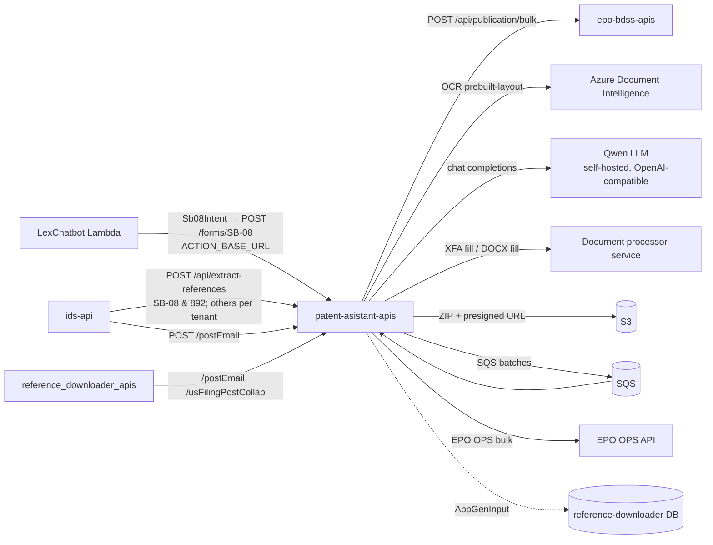

# patent-asistant-apis — Knowledge Transfer (focus areas)

Describes the code as of 2026-09-18 (`origin/main` at `901618a`, "[TAI-1212] SB-08 npl citation limits (#526)").

The repo name is spelled `patent-asistant-apis` (one "s"). The service is the **IP Assistant** ("JUNE") backend.

## Scope of this package

The repo is large (844 commits, 13+ contributors) and has a maintained doc set. This package covers the **handed-over areas** in depth and points to the existing docs for the rest.

| Focus area | Main code | Tickets |
|---|---|---|
| **SB-08 form generation** (the IDS form PTO/SB/08 from reference numbers and NPL text) | `controllers/formGeneration.controller.js` (`case "SB-08"`, NPL pre-validation), `services/documentProcessor/*` | TAI-339, 666, 697, 729, 767, 1161, 1212, TAI-134; #430, #493 |
| **NPL citation splitting** (LLM) | `services/npl/nplExtractor.js`, `prompts/npl_extraction_system_prompt.txt` | TAI-1212, TAI-134 |
| **LLM + OCR reference extraction** (`POST /api/extract-references`), used by ids-api's SB-08/892, Ref Count and Ref Check | `controllers/ocrLLM.controller.js`, `services/openai-llm`, `services/azure-document-intelligence`, `prompts/fetch_pdf_*` | #514, TAI-1200, TAI-1212 (shared with other developers) |
| **EPO bulk bibliographic data** (bulk refs, SQS worker, EPO key rotation) | `services/bulkRefDownloader/*`, `worker/*`, `controllers/bulkDownloader.controller.js` | TAI-775, 812, 816, 827, TP-207; the Bull → SQS move |
| Earlier: AIA-83 / AIA-81A forms, Swagger auth, Redis cluster compatibility | `controllers/formGeneration.controller.js`, `routes/swagger-auth.router.js` | TAI-221, 473 |

Other areas (chat and Lex actions, Office Actions, US Filing / AppGen, custom forms, bib-data exports, auth) are covered by `patent-asistant-apis: docs/`.

## What the service is

A multi-tenant Express 5 / Sequelize service for patent and trademark bibliographic exports, document downloads, USPTO form generation, filing packages, chatbot actions, and OCR/LLM extraction. It uses PostgreSQL (super-admin, master, reference-downloader and per-tenant DBs), Redis (caches and bulk-job state), and SQS (bulk EPO batches, consumed in-process). See `patent-asistant-apis: README.md`.

## How the focus areas connect to other repos

## Run locally

See `patent-asistant-apis: README.md` → *Requirements and local setup* (Node ≥ 22, `npm ci`, `npm run start:local`, port 8006). For extraction work, also set `QWEN_LLM_BASE_URL`, `QWEN_LLM_API_KEY` (required at startup), and the Azure Document Intelligence endpoint and key.

**Accuracy harness:** `scripts/extract-refs.js` (plus `scripts/testNplExtraction.js` and `scripts/npl_samples/`) runs the real extraction pipeline on local PDFs or on ODP application numbers and scores it against `.expected.json`. See [testing.md](testing.md).

## Existing documentation

| Doc | Use it for |
|---|---|
| `patent-asistant-apis: README.md` + `docs/api.md`, `architecture.md`, `configuration.md`, `database.md`, `operations.md`, `testing.md`, `reference-extraction.md`, `office-actions.md` | The maintained doc set (verified by its authors at `485a600`, 2026-09-04): bulk processing, SQS, configuration, the extraction pipeline |
| `patent-asistant-apis: docs/llm-ocr-kt.md` | The in-depth guide to `/api/extract-references`: the 4-layer defence design, `parseModelOutput` repair steps, `repairSections` rules, prompt structure (IDS vs PTO-892), change recipes, the harness. Written at `update-llm-ocr` @ `14b74a1` (2026-08-10); later changes are listed in [product-and-features.md](product-and-features.md#changes-since-docsllm-ocr-ktmd) |
| `patent-asistant-apis: .claude/docs/DECISIONS.md` and `traces/` | Decisions for TAI-1161 (N1–N6), the #526 rule changes (D1–D7), NPL retries, the prompt kind-code rule |
| `patent-asistant-apis: services/bulkRefDownloader/task.md`, `optimization.md` | The EPO OPS rate-limit model (hourly and weekly quotas, a 60 s retrieval throttle, throttling headers) and the Redis-based multi-key limiter design behind `tokenManager` / `rateLimiter`. Read before changing EPO bulk |
| `ids-api: docs/TAI-1181-deployment.md` | The SB-08 & 892 rollout, which depends on `/api/extract-references` |

## This package

| File | For |
|---|---|
| [product-and-features.md](product-and-features.md) | SB-08 Generator, NPL splitting, extraction changes, EPO bulk |
| [api-and-integrations.md](api-and-integrations.md) | The contracts other repos depend on; outbound systems |
| [auth-security.md](auth-security.md) | Trust model and data handling for the focus areas |
| [deployment-and-environments.md](deployment-and-environments.md) | Configuration to set per environment; rollout order |
| [testing.md](testing.md) | Suites and accuracy testing |
| [handover.md](handover.md) | Recent delivered work, dependencies, ownership |

Architecture, database, bulk queues and operations are in the repo's `docs/`.

## Suggested reading order

1. [product-and-features.md](product-and-features.md): SB-08 and NPL.
2. `docs/llm-ocr-kt.md` §1–§6 and §10, then the change list in product-and-features.
3. `.claude/docs/DECISIONS.md`.
4. [api-and-integrations.md](api-and-integrations.md) → [testing.md](testing.md) → [handover.md](handover.md).
