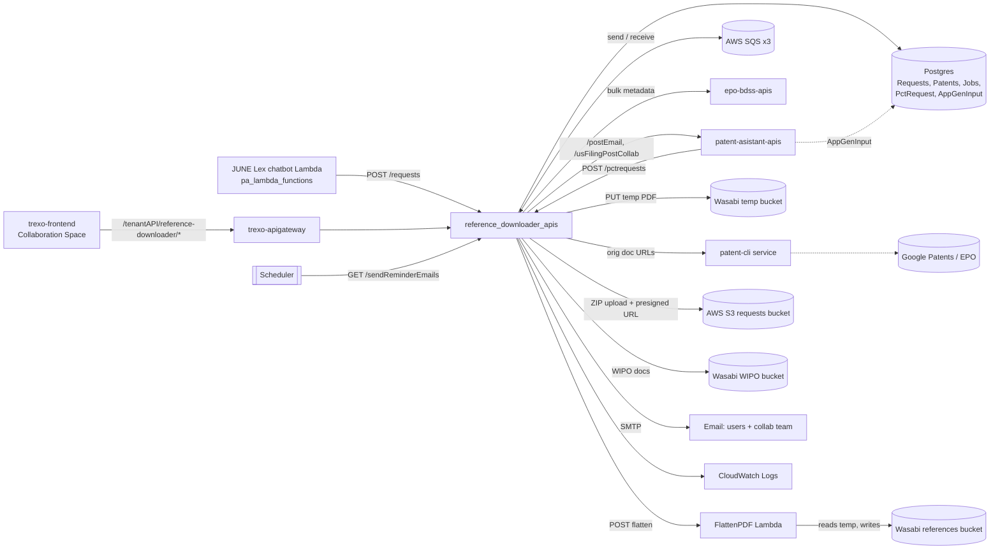
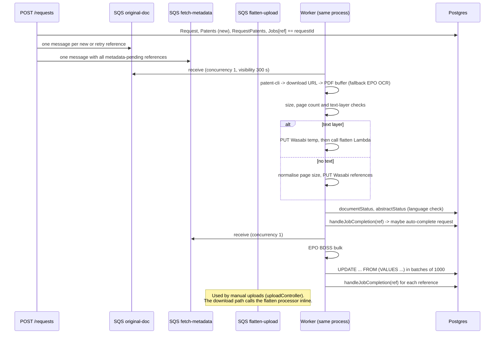

# reference_downloader_apis — Architecture

The repo's `REQUEST_FLOW_DIAGRAM.md` has per-endpoint flowcharts. The queue layer is **AWS SQS** (it replaced Bull on 2026-01-14, `99e4a25`).

## Style

A single Node process that is both the Express API and an **in-process SQS consumer**: `startWorker()` runs after `app.listen`. `worker/index.js` can also run on its own (`node worker/index.js`). It uses one shared Postgres database; tenant is a column on requests.

## System context

## Async pipeline

## Completion coordination

- The `Jobs` table is keyed by reference number. Its `requestId` column holds a comma-separated list of the requests waiting on that reference; `status` is `Pending` or `Complete` (`services/jobAssociation.js`).
- `handleJobCompletion(ref)` → for each waiting request, `autoCompleteEnglishSpeakingRequest` → compare-and-set `status → 'Processing'` → build ZIP → call the IP Assistant → `Auto Completed` (rolled back if a step does not complete).

## ZIP generation

- `generateZipForRequest` builds the ZIP with archiver (zlib level 9), streamed into an S3 multipart upload to `JUNE_REQUESTS_BUCKET_NAME`, key `Ref.D_<requestId>.zip`, and returns a presigned GET URL valid for `REQUEST_ZIP_EXPIRY` seconds.
- Each reference's PDF is built in memory: the abstract and the document are fetched from Wasabi and merged with pdf-lib, re-boxed if the page sizes differ, and split if larger than `MAX_PDF_PART_SIZE`.
- `GET /zip/:requestId` streams a fresh ZIP to the HTTP response. `GET /patent/:patentNumber` builds a single-reference ZIP in memory.

## State

| State | Where |
|---|---|
| Requests, references, statuses, SLA, sources | Postgres |
| Reference PDFs (global cache) | Wasabi `WASABI_REFERENCES_BUCKET_NAME` at `<CC><number><kind>/{bibliographic_abstract,original_document}.pdf` |
| Pre-flatten PDFs | Wasabi `WASABI_TEMP_BUCKET_NAME` |
| PCT documents | Wasabi `WASABI_WIPO_DOCS_BUCKET` at `<pctNumber>/<file>` |
| Request ZIPs | AWS S3 `JUNE_REQUESTS_BUCKET_NAME` |
| In-flight work | SQS |
| DB credentials | Resolved on the first connection (`db.js` `beforeConnect` hook) and cached |

## Startup and shutdown

- The HTTP server starts listening once DB credentials resolve (`resolveDbCredentials().then(startServer)`), which contacts Secrets Manager when enabled. The DB itself is contacted on the first query.
- **Graceful shutdown:** on SIGTERM/SIGINT the service closes HTTP, stops the pollers and waits up to 30 s for in-flight messages. A document job cut off at that point returns to SQS after its visibility timeout and runs again; its writes are idempotent.

## Module layout

- Controllers call external services and queue work directly.
- `services/epoService.js` uses `EPO_BDSS_URL` for bulk metadata and `PATENT_CLI_URL` for documents.
- `queues/*` processors take a Bull-style `job` object (`job.data`, `job.progress()`), which the SQS poller provides.
