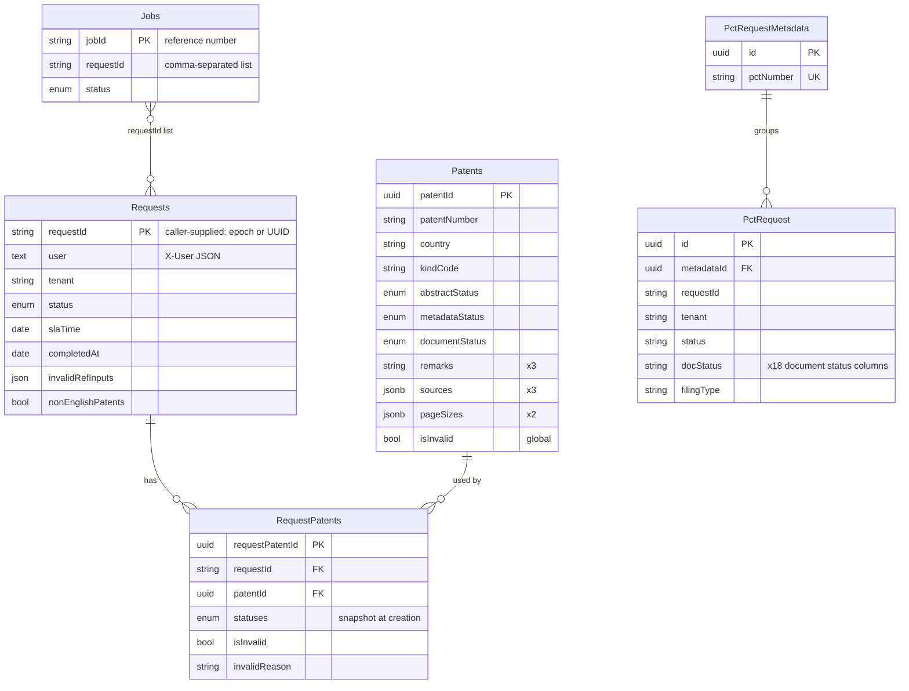

# reference_downloader_apis — Database

## Technology and connection

- One PostgreSQL database named by `DB_NAME`, through one Sequelize instance (default pool, max 5, shared by the API and the in-process worker). Credentials come from env vars or Secrets Manager, resolved in a `beforeConnect` hook and cached. The Secrets Manager secret may also carry `port` and `dbname` (`db.js`, `config/dbCredentials/*`).
- **Shared with `patent-asistant-apis`**, which opens its own connection (`REFERENCE_DOWNLOADER_DB`) and defines the `AppGenInput` model on it (`patent-asistant-apis: database.js`, `models/master/appGenInput.model.js`).

## Entities

Also present: `AppGenInput`, owned by `patent-asistant-apis` and migrated here; and a `Users` model.

## Key points

| Topic | Detail |
|---|---|
| Shared reference cache | `Patents` has one row per `(patentNumber, country, kindCode)` across all tenants |
| Status source | Completion checks read the statuses on `Patents`. `RequestPatents` holds a snapshot from creation, updated by manual uploads |
| `Jobs.requestId` | A comma-separated list of the requests waiting on a reference |
| ENUM statuses | Postgres ENUM types (for example `enum_Patents_metadataStatus`); adding a value needs a migration |
| `Request.status` ENUM | Includes both `Completed` and `Complete`, plus `Pending` / `Processing` |
| Metadata updates | Written in batches of 1000 with `UPDATE … FROM (VALUES …)` |

## Schema management

- **Migrations** (`sequelize-cli`, `npm run migrate[:env]`): 19 files dated 2025-06-19 to 2026-08-25. They alter the base tables (`addColumn` / `changeColumn` / `renameTable`) and create `AppGenInput` and `PctRequestMetadata`. Run them before starting new code in any shared environment. Applied migrations are recorded in `SequelizeMeta`.
- **`setup.js`** (`npm run setup[:env]`) creates the tables from the models with `sync({ force: true })`, dropping any that exist. Use it only for a new, empty local database.
- `config/config.js` exports an async function that resolves credentials; sequelize-cli uses it for migrations.
