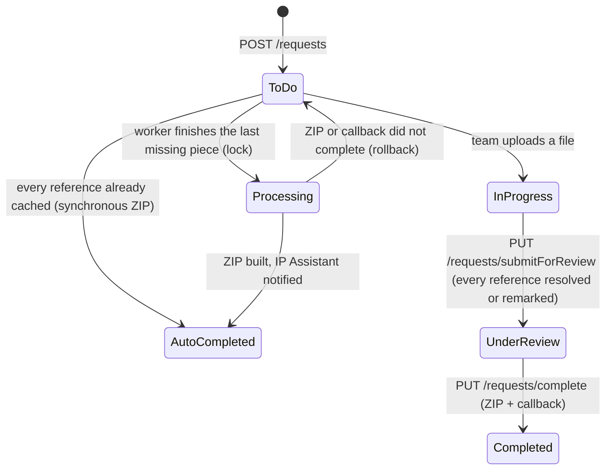

# reference_downloader_apis — Product and features

The repo's `PRODUCT_FLOW_DOCUMENTATION.md` is the product narrative; read it first. This file records the rules as the code implements them.

## Business problem

Patent practitioners cite prior-art references, for example in an IDS (Information Disclosure Statement), and file them as clean PDFs with bibliographic data. Gathering the full text, abstracts or translations and the metadata for dozens of references is manual work. The service automates what it can and routes the rest to an internal team under an SLA.

## Actors

| Actor | Role |
|---|---|
| End user (law-firm tenant, via the JUNE chatbot) | Submits reference numbers; receives a download link by chat and email |
| Collaboration Space team (internal) | Works the queue: uploads missing PDFs and metadata, marks references invalid, adjusts the SLA, submits for review, completes |
| IP Assistant (`patent-asistant-apis`) | Receives completion links (`/postEmail`); starts and receives PCT filing packages |

## Reference request lifecycle

Request statuses (`models/Request.js` ENUM): `To Do`, `In Progress`, `Pending`, `Processing`, `Under Review`, `Auto Completed`, `Completed`, `Complete`.

### Create (`POST /requests`)

`controllers/requestController.js`:

1. The caller supplies the `requestId` (epoch-style from the chatbot; UUIDs also exist). A duplicate id gets 400.
2. Each reference is upper-cased and parsed as `CC + number + kind code`. Invalid ones are recorded in `invalidRefInputs`. If **all** are invalid, the request is removed and the IP Assistant is told "Provide a valid reference number".
3. The reference is looked up in the **shared `Patents` cache** by `(patentNumber, country, kindCode)`:
   - **New:** a `Patents` row is created (US references get `abstractStatus=N/A`, "English PDF") and an original-document download job is queued.
   - **Cached, but metadata and document both "Not available at source":** the download is queued again.
   - **Cached otherwise:** the entry is reused. It counts as *pending* if any part is missing without a remark.
4. A `RequestPatents` row is created per reference, with a status snapshot.
5. Every pending reference gets the request id added to a `Jobs` row keyed by reference number, so worker completions can find the requests waiting on them.
6. The references still needing metadata go to the metadata queue as **one** message.
7. If nothing is pending and everything is `Available`, the ZIP is built within the HTTP call, the IP Assistant gets the link, and the status becomes `Auto Completed`. Otherwise the caller receives an SLA message; the user gets an "In Progress" email and the Collaboration team a "New Task" email.

### Automated completion

`services/jobCompletion.js`, `services/requestCompletion.js`:

After each worker job, `handleJobCompletion(refNum)` re-checks every request waiting on that reference. A request auto-completes when **every** reference has:
- abstract `Available`, or `N/A` for a US reference;
- metadata `Available`;
- document `Available`.

A compare-and-set to `Processing` ensures only one worker builds the ZIP.

Non-US references whose PDF is detected as English are marked for manual review (`handleExistingPatent` logs "Manual Review required"), so requests containing them are completed by the team.

### Manual path

- The team uploads an abstract and/or an original PDF, plus optional metadata, per reference (`POST /files/upload/:requestPatentId`), bulk-uploads metadata rows (`POST /metadata`), or records a remark saying an item is not available.
- `submitForReview` is allowed when every reference is resolved (`Available`, `N/A`, or `NotAvailable` with a remark) or marked invalid.
- `complete` builds the ZIP, calls the IP Assistant, and sets `Completed`. If the callback does not succeed, the request stays open and the ZIP URL is returned in the error response.

### Uploads update the shared cache

Documents and metadata uploaded for one request update the **global** `Patents` row, so every later request (any tenant) for that reference reuses them. Patent documents are public, so the cache is shared by design.

## SLA rules

`utils/sla.js`, time zone `America/New_York` (labelled "EST"):

| Rule | Value |
|---|---|
| ≤25 pending references, created before noon | 4 h |
| ≤25 pending references, created after noon | 16 h |
| >25 pending references | 18 h |
| Weekend rollover | Friday from 11 AM, or Saturday/Sunday → Monday 9 AM |
| Applies to | Any request with pending references |

The SLA produces the message shown to the requester and the `slaTime` shown to the team. The team can change it (`PUT /requests/sla/:requestId`, which emails the user and the team).

## SLA reminder

`GET /sendReminderEmails` emails the Collaboration team about requests created one calendar day earlier whose status is not `Completed` (`services/slaEmail.js`). Call it once a day.

## Language / abstract rule

- US references: treated as English; no abstract needed.
- Non-US: page 1 of the downloaded PDF is checked for at least one word from each set {Priority…}, {Inventor…}, {Applicant/Proprietor}, with Tesseract OCR if the page has no text layer. Found → abstract `N/A` ("English PDF"); missing → abstract `Pending` ("Non-English PDF. Missing: …"), and the team supplies an abstract or translation (`utils/isPDFEnglish.js`).

## Document rules

| Rule | Where |
|---|---|
| Downloaded PDFs under 100 KB are rejected ("Document too small") | `originalDocDownloadProcessor.js` |
| PDFs over `FLATTEN_MAX_PAGES` (default 1000) are not flattened; they stay `Pending` "File exceeds N-page limit" for the team | same |
| PDFs with a text layer are flattened by the Lambda (150 dpi, JPEG quality 35); PDFs without text are page-size normalised locally | `flattenUploadProcessor.js`, `uploadController.js` |
| Uniform page size is **US Letter** (TAI-1109, July 2026); the size is recorded on the `Patents` row so ZIP building can skip re-boxing | `utils/normalizePdfPages.js`, migration `20260702…` |
| In the ZIP, non-US file names are prefixed `For_`; large PDFs are split into parts (`MAX_PDF_PART_SIZE`) | `services/generateZip.js` |
| Invalid-reference reasons: `INVALID_REFERENCE`, `KIND_CODE_NOT_AVAILABLE` (TAI-1129). The frontend keeps a matching list; change both together | `utils/invalidReasons.js`; `trexo-frontend: pages/CollaborationSpace/utils/invalidReasons.js` |
| Source attribution is kept per part (`abstractSource` / `documentSource` / `metadataSource`: System, EPO, Google, or User with name and email) | models |

## PCT / 371 filing packages

`controllers/pctRequestController.js`:

- The IP Assistant creates a PCT request with `pctNumber`, `filingType` (`371application` → "371", otherwise "Bypass-Continuation") and the files it already has.
- Requests are grouped by `pctNumber` in `PctRequestMetadata`, across tenants. The status of each of 18 document types (RO101, ISA237, ISA210, IASR, SEQLIST, …) starts as `Present` or `Pending`, or is copied from an open request for the same PCT number.
- The team uploads the WIPO documents (stored in the Wasabi WIPO bucket under `pctNumber/`) or marks them unavailable, and the result is applied to all open requests for the same PCT number.
- `PUT /pctrequests/submit` marks the `Under Review` requests for that PCT number `Completed`, then notifies the IP Assistant (`/usFilingPostCollab`) with the tenant map.
- `GET /pctrequests` lists requests created in the last 7 days.

## Critical paths

1. The **SQS worker** (document download, metadata, flatten).
2. The **IP Assistant callback**, which is how the chatbot user learns the request is done.
3. The **Flatten Lambda** and **patent-cli**: when either is unavailable, references stay `Pending` with remarks for the team.
