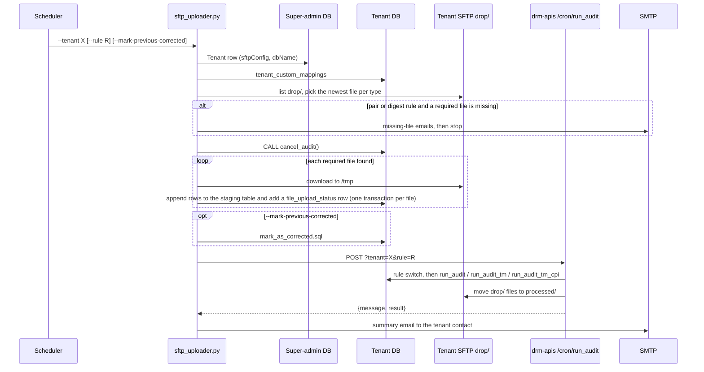

# scripts/drm — Architecture and flow

A single-process, synchronous batch job: one run handles one tenant. It keeps no state of its own; all state lives in the tenant DB, on the tenant's SFTP server and in drm-apis.

## Components

| File | Role |
|---|---|
| `drm/sftp_uploader.py` | Entry point (CLI). Orchestrates the run, recognises and selects files, sends most emails |
| `drm/file_processor.py` | `queueMappings` (per file type: target table, Excel column → DB column, date columns); Excel/XML parsing; loading into the tenant DB |
| `drm/run_audit.py` | `run_audit(tenant, rule)` → `POST {BASE_URL}/cron/run_audit?tenant=<code>[&rule=<rule>]` on drm-apis |
| `drm/mark_as_corrected.sql` | Optional close-out of open observations before the audit |
| `drm/email_server.py` | SMTP send (STARTTLS on port 587, comma-separated recipients) |
| `drm/aws_secrets.py` | Reads DB credentials from AWS Secrets Manager |
| `drm/logger.py` | One log file per day, `drm_cron_YYYY-MM-DD.log` under `LOGS_DIRECTORY`, with a `[tenant]` prefix |

CLI: `python sftp_uploader.py --tenant <tenantCode> [--rule <rule>] [--mark-previous-corrected]`. The `--tenant` value is the tenant **code** (`"Tenant"."tenantCode"`).

## End-to-end flow

### Step by step

1. **Credentials.** With `USE_SECRET_MANAGER` set, the DB host, user, password and port come from the Secrets Manager secret `DB_SECRET_NAME`. Otherwise they come from `DB_URL` (a host name), `DB_USER`, `DB_PASSWORD` and `DB_PORT`. One DB login serves the super-admin DB and the tenant DBs.
2. **Tenant lookup.** The script reads `tenantCode`, `tenantName`, `sftpConfig` and `dbName` from the super-admin `"Tenant"` table. The tenant contact (email and name) comes from the `TENANT_EMAILS` JSON setting, keyed by tenant code.
3. **Custom mappings.** The script reads `tenant_custom_mappings (file_name, mapping)` from the tenant DB. Each entry overrides the default column map for one file type. The stored mapping is in drm-apis orientation (DB column → Excel column), and the script inverts it.
4. **SFTP.** The script connects with paramiko using the host, port, username and password from `sftpConfig`, under the `DRM_SFTP_DIRECTORY` root.
5. **Required files for the rule.** See the table below.
6. **File recognition.** `get_file_name` lower-cases the file name and returns the first mapping key it **contains** (substring match, in dictionary order). For example, `pair_pa` or `outgoingcorrespondence` → `PairPA`, and `output` → `90dayOutput`. Files that match no key are skipped. For the `digest` rule, files are recognised by extension (any `.xml` → `PairPA`, any `.xlsx` / `.xls` → `90dayOutput`).
7. **Newest wins.** When several files map to the same type, the one with the latest modification time is used. For `ClosedDocket*`, the `pair` rule prefers names containing "PAIR", and every other rule prefers names without it.
8. **Empty `drop/`.** The script sends a "DRM Audit Not Executed – No Files Found" email to `EMAIL_RECIPIENT` and stops.
9. **Missing files.** The `pair` and `digest` rules stop the run: the tenant contact is asked for the missing USPTO correspondence file (`PairPA`) or PL Digest report (`90dayOutput`), and `EMAIL_RECIPIENT` gets the list. Other rules carry on with what is present, and the missing files are listed in the final email.
10. **`CALL cancel_audit()`** runs in the tenant DB. It clears the eight FIP staging tables and `file_upload_status`, so each run starts from a clean batch.
11. **Load.** For each required file, the script downloads it to `/tmp/<epoch>_<tenant>_<file>` and calls `load_excel_to_postgres(<type>, …)`:
    - XML (the USPTO correspondence export) is read with `pandas.read_xml`.
    - For Excel, the header row is the **last bold row** (`find_last_bold_row`). Everything is read as strings with openpyxl; footer rows are handled; date columns are parsed.
    - Excel columns are mapped **by position**; the XML file is mapped by element name.
    - `TREXO-*` (Inprotech-format) files keep blank cells as empty strings.
    - In one transaction per file, it checks that `file_upload_status` has no active row for the type, appends the rows to the staging table and inserts a status row with `isactive = '1'`.
    - If a file fails to load, the run stops before the audit step.
12. **Ignored files.** Recognised files that the rule does not need are listed in an email to `EMAIL_RECIPIENT`.
13. **Optional close-out** (`--mark-previous-corrected`). `mark_as_corrected.sql` sets every open row in `audit_result` and `audit_result_tm` with a batch date before today to managed and archived, with `processed_by = 'System'` and `action_taken = 'Corrected'`. Observations the new audit detects again then appear as "Recurring Errors (Previously Marked as Corrected)" in the email.
14. **Audit via drm-apis.** `POST /cron/run_audit?tenant=<code>[&rule=<rule>]`. On the drm-apis side:
    - `rule=pair` switches the tenant to the PAIR rules, and `cpi` to the CPI rules. `all` and `all-except-pair` make all rules active. `digest`, `inprotech`, `wbd` or no rule: no switch.
    - It checks the active `file_upload_status` rows, allows one file family per run, and runs the matching procedures.
    - After the procedures run, it moves the files in `drop/` to `processed/<name>_<datetime>.<ext>`.
    - It emails its own report to the drm-apis tech mailbox and returns `{message, result}`.
15. **Tenant email.** When `result` has a `patent` or `trademark` section, the tenant contact gets "DRM Audit Completed for <tenant> <date> – Summary of Observations": per section, the unique and recurring observations, the files used and the missing files.

## Rules and required files

| `--rule` | Required files (logical names) | If a file is missing | drm-apis rule switch |
|---|---|---|---|
| none | `BibliographicPA`, `ClosedDocketPA`, `OpenDocketPA`, `PairPA`, `IndiaMattersPA`, `WorkingStmtPA`, `ClosedDocketTM`, `BibliographicTM` | Continue | None (no `rule` parameter sent) |
| `all` | Same as above | Continue | All rules active |
| `all-except-pair` | The "all" list without `PairPA` | Continue | All rules active |
| `pair` | `PairPA`, `ClosedDocketPA` | **Stop** | PAIR rules |
| `cpi` | `CPI_BibliographyTM`, `CPI_Create_ActionTM`, `CPI_Last_ActionTM`, `User Name` | Continue | CPI rules |
| `digest` | `PairPA` (`.xml`), `90dayOutput` (Excel) | **Stop** | None |
| `inprotech` | Five `TREXO-*` exports (bibliographic PA and TM, open docket PA, India matters PA, working statement PA) | Continue | None |
| `wbd` | `BibliographicTM`, `ClosedDocketTM`, `FIP Audit Dump`, `OpenDocketTM` | Continue | None |

The lists live in `REQUIRED_FILES` in `sftp_uploader.py`. For what each family audits, see [../drm-apis/product-and-features.md](../drm-apis/product-and-features.md).

## Data written

| Where | What |
|---|---|
| Tenant DB, staging tables (one per file type, `queueMappings[…].table`) | Appended rows |
| Tenant DB, `file_upload_status` | One active row per loaded file type |
| Tenant DB, FIP staging tables and `file_upload_status` | Cleared by `cancel_audit()` before loading |
| Tenant DB, `audit_result`, `audit_result_tm` | Close-out update (optional) |
| Host `/tmp` | Downloaded client files |
| Tenant SFTP | Nothing written by the script; drm-apis moves the files after the audit |

**Coordinating with UI uploads:** each run calls `cancel_audit()`, which clears the tenant's current upload batch, including files a user has uploaded through the DRM UI but not yet audited. Schedule manual UI work for SFTP tenants outside the job's run time.

## Column mappings

The script's `file_processor.queueMappings` and drm-apis `queue/queueMappings.json` describe the same 20 file types in different shapes:

- the script maps Excel column position → DB column and adds `table` and `date_columns`;
- drm-apis maps DB column → Excel column and adds `includeLastRow`;
- some keys are spelled differently, for example `BibliographicPa` vs `BibliographicPA`, `Digest` vs `90dayOutput`, `UserName` vs `User Name`.

Tenant custom mappings (`tenant_custom_mappings`) override both copies for that tenant. For a change that applies to every tenant, update both files together.
