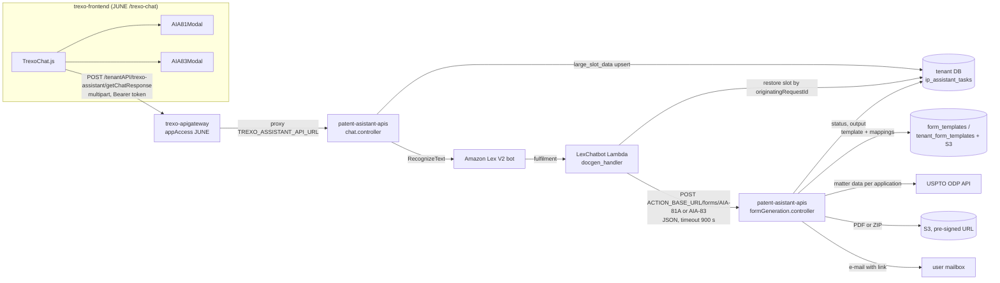

# Architecture: how an AIA-81A / AIA-83 request travels

## Shape

The frontend part is a thin form layer inside the JUNE chat page. JUNE is a chat client for an **Amazon Lex V2** bot. Every chat turn goes from the browser through the gateway to patent-asistant-apis, which calls Lex `RecognizeText`. A form is far larger than a Lex slot can hold, so the AIA forms use the platform's **large-slot mechanism**:

1. The real form is stored in a database row.
2. Lex receives the placeholder `"Sample Text"` for the slot.
3. The fulfilment Lambda swaps the real value back in before it builds the generator request.

## End-to-end sequence

```mermaid
sequenceDiagram
  autonumber
  actor U as User
  participant FE as TrexoChat + modal
  participant PA as patent-asistant-apis /trexo-assistant
  participant L as Lex V2
  participant F as LexChatbot Lambda
  participant G as /forms/:formCode generator
  U->>FE: choose task "PoA/Revocation…" (or AIA-83 task)
  FE->>PA: getChatResponse textInput=task label
  PA->>L: RecognizeText
  L-->>PA: elicit slot formDetails (+ originatingRequestId)
  PA-->>FE: messages + sessionState (requestId set by PA)
  U->>FE: application numbers
  Note over FE: simplifyApplicationNumbers.<br/>Nothing is sent. The modal opens.
  U->>FE: fill form, Submit
  FE->>PA: getChatResponse textInput="Sample Text",<br/>largeSlotData=<form string>, slotName=formDetails,<br/>originatingRequestId, requestId, intentName
  PA->>PA: addInitialRecord → ip_assistant_tasks.large_slot_data = {formDetails: …}
  PA->>L: RecognizeText "Sample Text"
  L->>F: fulfil AIA81ADocgenIntent / AIA83DocgenIntent
  F->>F: upsert task row, restore formDetails from DB
  F->>G: POST /forms/AIA-81A or /forms/AIA-83 (JSON)
  G->>G: per application: USPTO data → fill PDF
  G->>G: upload to S3, update task, send e-mail
  G-->>F: {url, errorMessages}
  F-->>L: PlainText reply (request ID, link, errors)
  L-->>PA: response
  PA-->>FE: messages
  FE-->>U: chat reply. Output also arrives by e-mail and in Track Task.
```

Whether the chat shows the generator's result, or an early "being processed… delivered to your mailbox" reply, depends on the bot's fulfilment settings in the Lex console. The frontend handles both: an empty message content is replaced with the "Your request ID … is being processed …" text.

## Components inside the frontend

| Piece | State it owns | Notes |
|---|---|---|
| `TrexoChat.js` | `chatSessionId` (uuid v4, also the Lex session id), `slotName`, `intentName`, `originatingRequestId`, `requestId`, `aia81Intent` / `aia81ApplicationNums`, `aia83Intent` / `aia83ApplicationNums` | Opens a modal when `slotName === "formDetails"` and the intent name matches (case-insensitive). The modal is shown while the intent flag is true and the numbers string is non-empty |
| `AIA81Modal.js` / `AIA83Modal.js` | the whole form as one nested `useState` object, plus `isRequiredField` (show errors) | They receive `handleModuleSubmit`, `handleStop`, `setMessages`, the two request ids and the numbers. They do not call the API themselves |
| `handleModuleSubmit` | none | Builds the multipart body. With `largeSlotData` present it sends `textInput = "Sample Text"`, `largeSlotData`, `originatingRequestId`, `requestId`, `slotName`, and always `sessionId` and `intentName` |
| `handleStop` | resets everything | New `chatSessionId`, clears the slot, intent and both AIA flags. Called by the modal's X button and on any request error |

The modal is an MUI `Modal` without `onClose`, so only X, Submit or an error closes it.

## Identifiers

| Id | Created by | Used for |
|---|---|---|
| `chatSessionId` | frontend (`uuidv4()`), renewed after cancel, error or a closed dialog | Lex `sessionId`, and the `sessionId` header and field |
| `requestId` | patent-asistant-apis, `String(Date.now())`, on every `getChatResponse` call, stored in Lex session attributes | Shown to the user. Sent by the Lambda as the `request-id` header to the generator. Key for the S3 folder and the task's `request_id` |
| `originatingRequestId` | Lex (`sessionState.originatingRequestId`) | Key of the `ip_assistant_tasks` row that carries `large_slot_data` |

## Data persisted along the way

The frontend persists nothing. Downstream, in the tenant database (`ip_assistant_tasks`, shared by patent-asistant-apis and pa_lambda_functions):

- `large_slot_data` (JSONB) = `{ "formDetails": "<the string the modal built>" }`, written by `addInitialRecord` with status "Ready for fulfillment", and merged if the row already exists.
- The Lambda then sets `task_type`, `sub_task`, `request_id`, `status`, `request_json` (the full Lex event) and `user_id`.
- The generator writes the output link, error messages and `status` (`Success` if any file was produced, otherwise `Failed`).

The table schema is in `pa_lambda_functions: LexChatbot/lambda_function/models.py` and its Alembic migrations.

## Sync and async

Everything is synchronous HTTP from the browser to Lex and from the Lambda to the generator. There is no queue. The generator processes application numbers in parallel inside one request: `FORM_GENERATION_CONCURRENCY`, default 3.

## Timing and limits

| Limit | Value | Where |
|---|---|---|
| Application numbers per request | `REACT_APP_JUNE_APPLICATION_NUMBER_LIMIT` | frontend `simplifyApplicationNumbers` |
| Lambda → generator HTTP timeout | 900 s | `docgen_handler.py` |
| Parallel application numbers inside one generator request | `FORM_GENERATION_CONCURRENCY`, default 3 | generator |
| Template load | cached per tenant and template path, with an S3 fallback | generator `getTemplate` |
| USPTO data | one ODP lookup per distinct application number, cached for the request | generator |

## Differences between the two forms

| | AIA-81A | AIA-83 |
|---|---|---|
| Serialisation | `cleanData` (`""` → `null`), `JSON.stringify`, then key quotes removed (`{attorneyUpdateMethod:"powerOfAttorney",…}`) | plain `JSON.stringify` |
| Lambda parsing | regex `(\w+):` → `"\1":`, `True`/`False`/`None` → JSON literals, `json.loads` | `safe_json_loads` (the same literal conversion, plus a double-decode) |
| Options supported downstream but not offered in the UI | correspondence `skip` and `firmOrIndividual` (firm name and address fields) | `comments`, `effectiveDate` (defaults to today), `replacementAttorney`, `replacementAttorneyRegNumber` |

The exact contracts are in [api-and-integrations.md](api-and-integrations.md).
